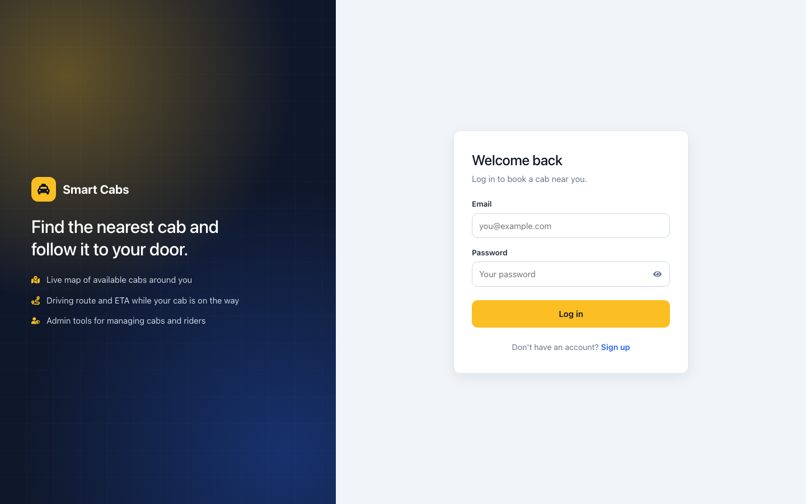
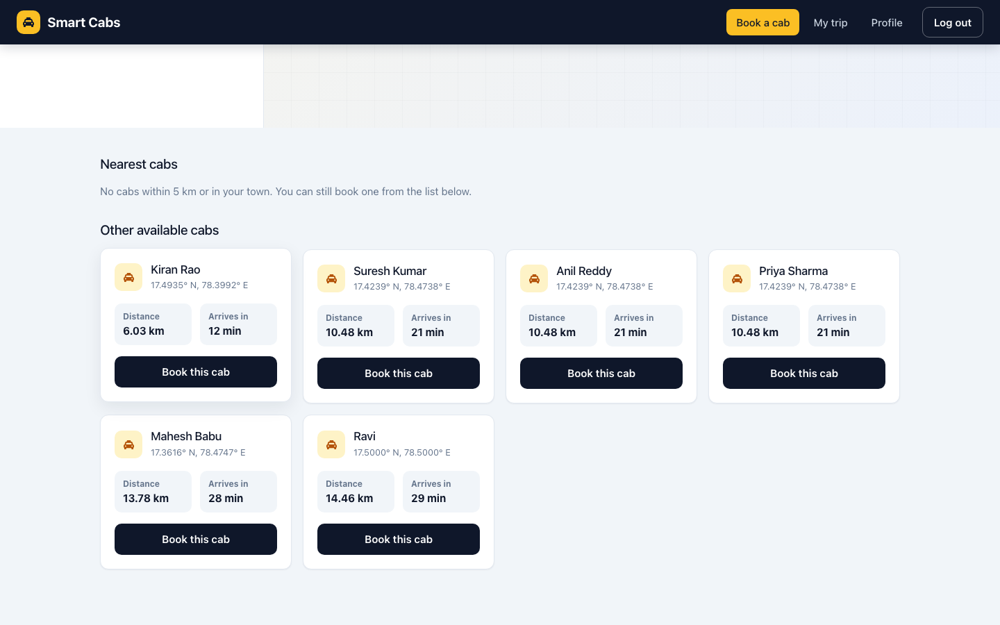
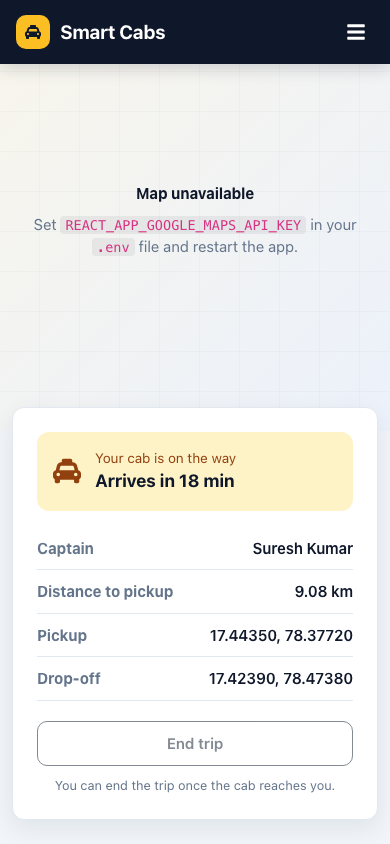
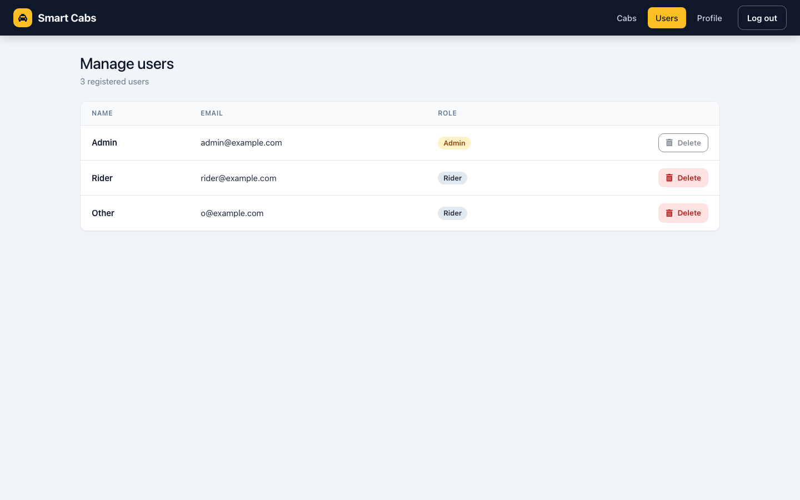

> **📦 Archived:** this repo is kept for history. Active development continues in the combined repository **[smart-cab-allocation](https://github.com/VamsiKrishnaThota03/smart-cab-allocation)**, which contains the same frontend and backend code.

# Smart Cab Allocation - Frontend

A React web app for finding, booking and tracking nearby cabs on Google Maps. It also includes an admin dashboard for managing cabs and users.


> **Related repositories**
> - Backend (Express + MongoDB): [smart-cab-allocation-backend](https://github.com/VamsiKrishnaThota03/smart-cab-allocation-backend)
> - Combined repo (frontend + `backend/` folder): [smart-cab-allocation](https://github.com/VamsiKrishnaThota03/smart-cab-allocation)

## Live demo

**https://smart-cab-allocation-frontend.vercel.app/login**

Sign up to try it as a rider. Admin accounts are not shared publicly; the backend grants admin rights to the emails in its `ADMIN_EMAILS` setting.

## Screenshots

| Log in | Cab search results |
| --- | --- |
|  |  |

| Trip on mobile | Manage users (admin) |
| --- | --- |
|  |  |

The screenshots were taken locally with sample data and no Google Maps key, so the map areas show the "Map unavailable" placeholder. With a key set they show the Google map, markers and route.

## Features

**Riders**
- Sign up and log in with JWT auth. Expired tokens send you back to the login page.
- A Google Map shows your location (browser Geolocation API) and every available cab as a taxi marker.
- Enter pickup and drop-off coordinates, or click **Pick on map**, then search:
  - every available cab is sorted by straight-line distance (Haversine formula) with an ETA at an average city speed of 30 km/h
  - **Nearest cabs** are those within **5 km** or in the same **town or pincode** as the pickup (reverse geocoding through the backend)
- Book a cab. Booking is atomic on the server, so two riders cannot take the same cab, and each rider has one active booking at a time.
- **My trip**: the driving route from the cab to you (Google Directions API) with the cab animated along it, the remaining distance and ETA. When the cab arrives, **End trip** moves it to your drop-off point and frees it. The page survives a reload, and a booking left over from another session can be released.
- Profile page

**Admins**
- Add a cab (captain name, phone, email, location). Set the location by clicking the map, typing coordinates or using your current position; town and pincode come from reverse geocoding.
- List users and delete non-admin users.
- Admin pages and API routes check the `isAdmin` claim in the signed JWT. Admin rights are given only to emails listed in `ADMIN_EMAILS`.

**UI**
- One colour palette and type scale, visible focus states, labelled form fields
- Responsive layouts with a mobile menu
- Loading, empty and error states instead of `alert()` pop-ups

## Tech stack

| Area | Tools |
| --- | --- |
| UI | React 18, Create React App (`react-scripts`), React Router 6, `react-icons`, Bootstrap 5 reboot + custom CSS |
| Maps | Google Maps JavaScript API (Maps, Markers, Directions) via `@react-google-maps/api` |
| HTTP / auth | `axios`, `jwt-decode` |
| Tests | Jest, React Testing Library |
| Hosting | Vercel |

## Project structure

```
smart-cab-allocation-frontend/
├── public/                     # index.html, favicon, manifest
└── src/
    ├── App.js                  # routes
    ├── config.js               # API URL, Maps key, ETA settings
    ├── hooks/useGoogleMaps.js  # loads the Maps API once
    ├── utils/                  # auth (session), geo (distance, formatting), trip helpers
    └── components/
        ├── Login.js, SignUp.js, AuthLayout.js, PasswordInput.js
        ├── Home.js             # map, nearest-cab search, booking
        ├── MyCab.js            # route + simulated cab movement, end trip
        ├── UserDetails.js      # profile
        ├── AdminDashboard.js   # add cab via map
        ├── AdminUsers.js       # list / delete users
        ├── Navbar.js, AdminNavbar.js, MapStatus.js
        └── PrivateRoute.js     # auth + admin route guard
```

### Routes

| Path | Access | Page |
| --- | --- | --- |
| `/login`, `/signup` | Public | Authentication |
| `/` | User | Map, cab search and booking |
| `/myCab` | User | Track the booked cab and end the trip |
| `/profile` | User | Profile |
| `/admin-dashboard` | Admin | Add cabs |
| `/admin/users` | Admin | Manage users |

## Getting started

### Prerequisites

- Node.js 18 or newer and npm
- A running backend ([smart-cab-allocation-backend](https://github.com/VamsiKrishnaThota03/smart-cab-allocation-backend)), locally on port 5001 by default
- Optional: a Google Maps browser key

### Install and run

```bash
git clone https://github.com/VamsiKrishnaThota03/smart-cab-allocation-frontend.git
cd smart-cab-allocation-frontend
npm install
cp .env.example .env     # then edit the values
npm start                # http://localhost:3000
```

| Command | Description |
| --- | --- |
| `npm start` | Start the dev server |
| `npm run build` | Production build into `build/` |
| `npm test` | Run the tests |

### Environment variables

| Variable | Required | Description |
| --- | --- | --- |
| `REACT_APP_API_URL` | No | Backend base URL. Defaults to `http://localhost:5001` in development and `https://smart-cab-allocation-backend.onrender.com` in production builds |
| `REACT_APP_GOOGLE_MAPS_API_KEY` | For maps | Browser key with the Maps JavaScript and Directions APIs enabled. Restrict it by HTTP referrer in the Google Cloud console. Without it the app still works, but the maps show a placeholder and the trip view moves the cab in a straight line |

`REACT_APP_*` values are baked in at build time, so restart `npm start` (or redeploy) after changing them.

## Deployment notes (Vercel)

- Set `REACT_APP_GOOGLE_MAPS_API_KEY` in the project's environment variables and redeploy. The key used to be hard-coded in the source; it has been removed from the code but is still in the git history, so restrict it to your domains or rotate it.
- Set `REACT_APP_API_URL` only if the API is not at `https://smart-cab-allocation-backend.onrender.com`.
- The backend needs `CORS_ORIGIN` to include the Vercel domain if it restricts origins.

## Known limitations

- The trip is a simulation: the cab marker is animated along the route in the browser, not driven by real GPS updates.
- Locations are entered as `latitude, longitude` text or picked on the map; there is no address search box.
- The town/pincode match makes one reverse-geocoding request per cab (cached while the page is open), so it gets slow with many cabs.
- JWTs are kept in `localStorage` and expire after one hour.
- `npm audit` still reports issues inside `react-scripts` (Create React App) that need a breaking upgrade to fix.
